  

  
  
  

### About me

I'm a student who builds things for the web, and I care most about how they *feel*: clear type, honest numbers, motion that explains instead of decorates.

I also love designing things you can hold. I model parts in CAD, test them with simulation and CFD, wire up ESP32 and Arduino projects, and 3D print the results. Away from the desk I'm out with a camera, travelling, then editing the photos and videos afterwards.

- **Design first.** I sketch the experience before the code: layout, typography, spacing and motion.
- **Build end to end.** From the database and API to the last hover state.
- **Ship, then sharpen.** Version by version, from real feedback.

### Now building

### Toolkit

### Contributions

<picture>
  <source media="(prefers-color-scheme: dark)" srcset="https://raw.githubusercontent.com/ifanshmy/ifanshmy/output/snake-dark.svg">
  
</picture>

Thanks for stopping by. Every pixel, considered.

