  

  
  
  
  

### About me

I'm a student who builds things for the web, and I care most about how they *feel*. Clear type, honest numbers, motion that explains instead of decorates, and the small details that make a page feel considered.

- **Design first.** I sketch the experience before the code: layout, typography, spacing and motion.
- **Build end to end.** From the database and API to the last hover state and the email that lands in your inbox.
- **Ship, then sharpen.** Version by version, from real feedback, until it feels right.
- **Ask me about** web design, UI and turning messy data into calm dashboards.

### Now building

**[TradeDesk](https://ifanshmy.github.io/tradedesk/)** reads monthly statements from Moomoo, Mplus and Webull (even password-protected PDFs), verifies every figure before saving, and turns them into a dashboard of NAV, performance, dividends and goals.

<table>
  <tr>
    <td width="33%" valign="top"><b>Checked before it counts</b> Every upload is simulated with the real maths and shown as before → after.</td>
    <td width="33%" valign="top"><b>Private by design</b> Encrypted statement data, attempt limits, a security log, no PDFs stored.</td>
    <td width="33%" valign="top"><b>Made to feel good</b> Seven colour themes, light and dark, a magnetic cursor and a reduce-motion switch.</td>
  </tr>
</table>

  

### Tools I build with

  

### Contributions

<picture>
  <source media="(prefers-color-scheme: dark)" srcset="https://raw.githubusercontent.com/ifanshmy/ifanshmy/output/snake-dark.svg">
  
</picture>

Thanks for stopping by. Every trade, grounded. Every pixel, considered.

